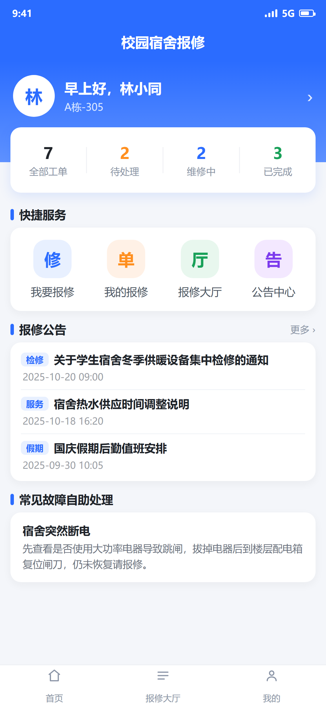
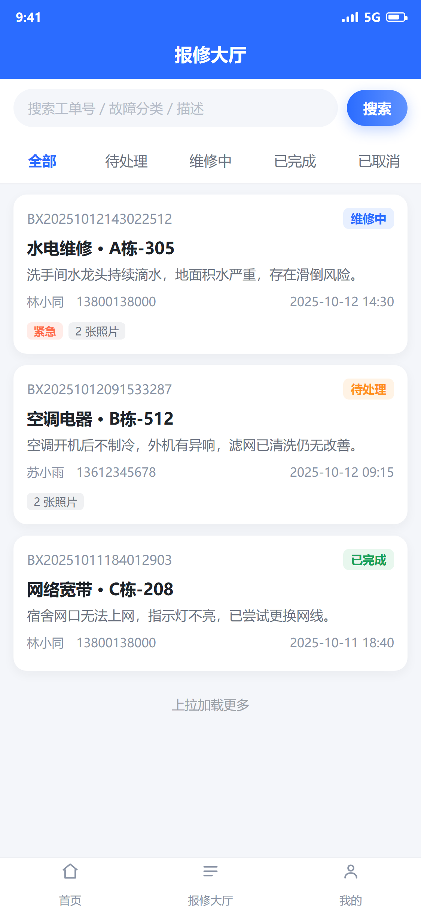
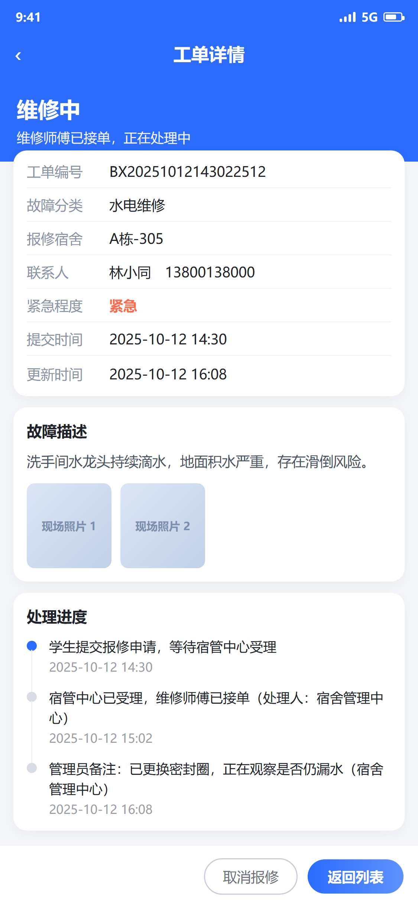
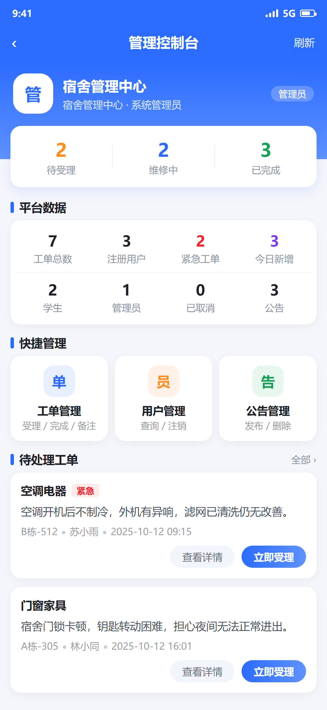
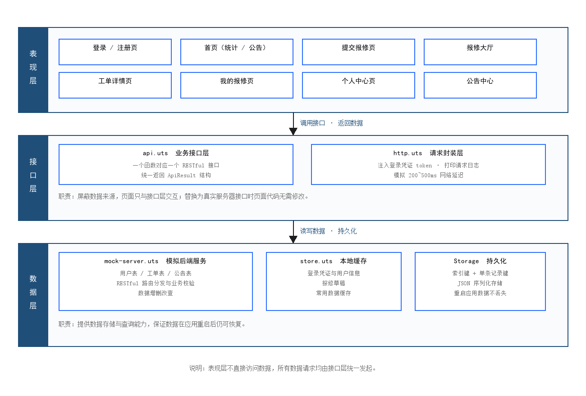
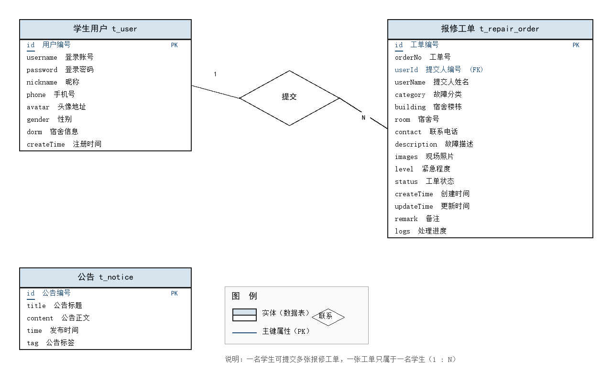
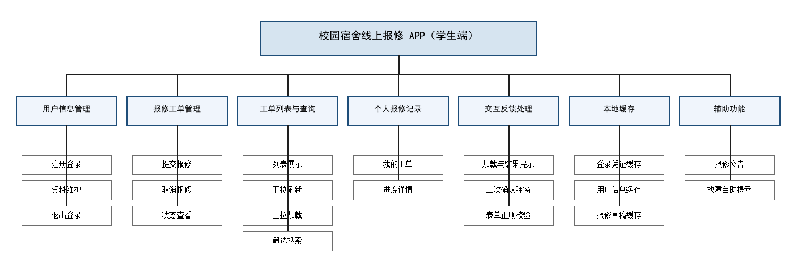
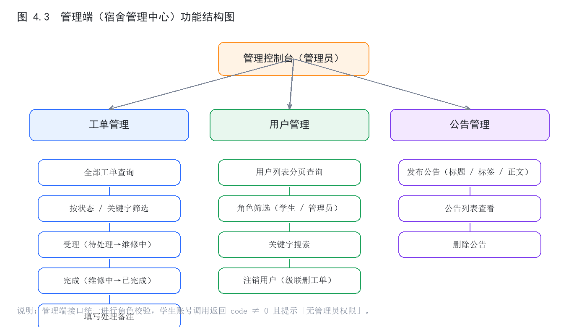
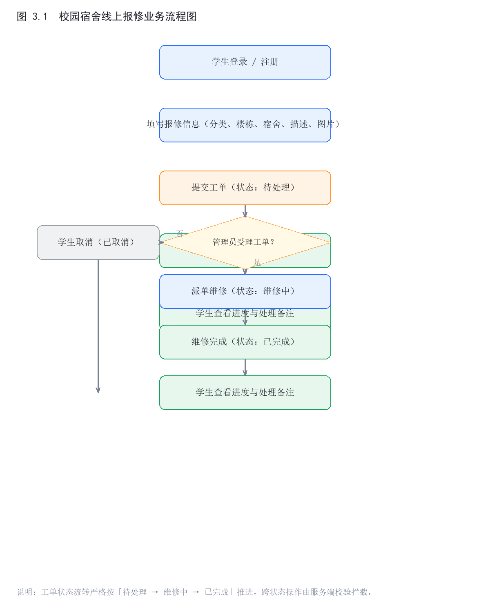

# 校园宿舍线上报修 APP

> 学生扫码报修、管理端派单处理的一体化宿舍报修系统。
> uni-app x（uvue / uts）前端 + Node.js 零依赖后端，一套代码跑 H5、Android、iOS。

<p>
  
  
  
  
</p>

## 预览

| 首页 | 报修工单列表 |
| --- | --- |
|  |  |

| 工单详情 | 管理端总览 |
| --- | --- |
|  |  |

## 架构与设计

| 系统架构 | 数据库 ER 图 |
| --- | --- |
|  |  |

| 功能结构 | 管理端结构 |
| --- | --- |
|  |  |

| 报修流程 |
| --- |
|  |

## 功能

**学生端**

- 注册 / 登录，个人资料维护（宿舍、手机号、性别）
- 提交报修：故障分类、楼栋房号、联系方式、问题描述、紧急程度、图片
- 我的工单：分页列表、状态筛选、关键字搜索、详情与进度日志、取消报修
- 公告列表与公告详情、个人工单统计

**管理端（需 admin 角色）**

- 平台总览：用户数、各状态工单数、紧急工单、今日新增
- 工单管理：推进状态（待处理 → 维修中 → 已完成）、填写处理备注、删除工单
- 用户管理：分页 + 角色筛选 + 关键字，注销用户（级联清理工单，保留最后一个管理员）
- 公告管理：发布 / 修改 / 删除

## 技术栈

| 层次 | 选型 |
| --- | --- |
| 前端框架 | uni-app x，uvue 页面 + uts 逻辑，Vue 3 语法 |
| 状态与请求 | 自写 `store` / `http` / `convert` 层，内置多地址自动探测 |
| 后端 | Node.js 内置 `http` 模块，**零第三方依赖**，15 个 RESTful 接口 + 健康检查 |
| 数据 | JSON 文件持久化（`server/data/db.json`），三张表 + 自动写入演示数据 |
| 双数据源 | `common/mock-server.uts` 提供本地模拟后端，改一个开关即可在「真实后端 / 模拟后端」之间切换 |

## 目录结构

```
.
├─ App.uvue / main.uts          应用入口
├─ pages.json                   页面与导航配置
├─ manifest.json                应用配置
├─ pages/
│  ├─ index/                  首页
│  ├─ login/  register/       登录、注册
│  ├─ repair/                 报修提交、列表、详情、我的工单
│  ├─ notice/                 公告列表与详情
│  ├─ user/                   个人中心
│  └─ admin/                  管理端（总览、工单、用户、公告）
├─ common/                      请求层、状态管理、类型定义、模拟后端、工具
├─ server/                      后端服务（详见 server/README.md）
├─ static/                      静态资源
└─ docs/                        架构图、流程图、界面截图
```

## 快速开始

### 1. 启动后端

```bash
cd server
node server.js        # 默认 http://127.0.0.1:3000/api
npm test              # 接口自测（需服务已启动）
node db.js --reset    # 数据恢复为演示数据
```

Windows 也可以直接双击 `server/start-server.bat`。

### 2. 运行前端

用 HBuilderX 打开本目录，选择“运行 → 运行到浏览器 / 手机模拟器 / 真机”。
请求层默认连接真实后端（`common/http.uts` 中 `USE_REAL_SERVER = true`），并按 127.0.0.1 → 10.0.2.2 → 局域网 IP 的顺序自动探测可用地址。

### 3. 演示账号

| 角色 | 账号 | 密码 |
| --- | --- | --- |
| 管理员 | `admin` | `123456` |
| 学生 | `student` | `123456` |
| 学生 | `xiaoyu` | `123456` |

## 接口与数据库

15 个业务接口 + 健康检查，管理端另有一组接口并统一做角色校验；三张表 `t_user` / `t_repair_order` / `t_notice`。
完整清单、参数约定、数据模型与踩坑说明见 [server/README.md](server/README.md)。

## 说明

- 本项目为课程设计作品，演示账号密码仅用于本地运行，请勿用于生产环境。
- 后端为单机 JSON 持久化，未做并发锁与权限加密，适合演示与课程场景。

---

作者：[@WL-117](https://github.com/WL-117) · 欢迎提 Issue 交流
